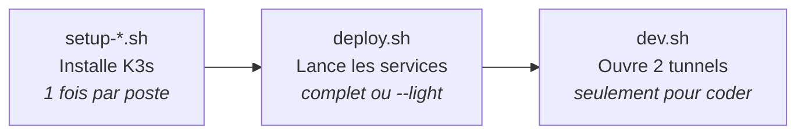
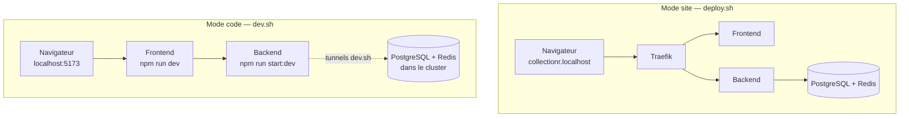

# Onboarding — Environnement local CollectionR

Objectif : être opérationnel **en moins d'1 heure**, quel que soit ton OS.

Ce guide te dit **quoi faire et dans quel ordre**.
Les détails techniques sont dans [`devops/README.md`](./README.md) : on y renvoie quand il le faut.

> Bloqué plus de 15 minutes ? Va voir la section [Qui contacter](#9-qui-contacter).

---

## Vue d'ensemble



---

## Sommaire

1. [Prérequis](#1-prérequis)
2. [Installer K3s](#2-installer-k3s-une-seule-fois)
3. [Premier déploiement](#3-premier-déploiement-une-seule-fois)
4. [Routine au rallumage du poste](#4-routine-au-rallumage-du-poste)
5. [Voir le site dans le navigateur](#5-voir-le-site-dans-le-navigateur)
6. [Mode code (devs Front + Back)](#6-mode-code-devs-front--back)
7. [Comprendre Traefik en 2 minutes](#7-comprendre-traefik-en-2-minutes)
8. [Erreurs fréquentes](#8-erreurs-fréquentes)
9. [Qui contacter](#9-qui-contacter)
10. [TODO connus](#10-todo-connus)

---

## 1. Prérequis

| Quoi | Pour qui | Comment vérifier |
|---|---|---|
| Git | Tout le monde | `git --version` |
| Docker | Tout le monde (build des images) | `docker --version` |
| Node.js + npm | Devs JS/TS (Front, Back) | `node -v` et `npm -v` |
| 8 Go de RAM minimum | Tout le monde | 8 Go → utilise le mode `--light` |

⚠️ **Node.js n'est pas installé par les scripts K3s.** Installe-le à part si tu codes en JS/TS.

**Windows** : tout se passe **dans le terminal Ubuntu (WSL2)**, pas dans PowerShell.

---

## 2. Installer K3s (une seule fois)

1. Clone le repo et place-toi à la racine :
   ```bash
   git clone <url-du-repo> collectionr
   cd collectionr
   ```
2. Lance le script de **ton** OS :

| OS | Script |
|---|---|
| Linux | `./devops/scripts/setup-local.sh` |
| Windows (WSL2 / Ubuntu) | `./devops/scripts/setup-wsl2.sh` |
| macOS (Rancher Desktop / OrbStack) | `./devops/scripts/setup-macos.sh` |

3. **Windows uniquement** : si le script te dit qu'il a activé systemd :
   - ferme Ubuntu ;
   - dans PowerShell : `wsl --shutdown` ;
   - rouvre Ubuntu et relance le script.
4. Vérifie :
   ```bash
   kubectl get pods -A
   ```
   ✅ Tout est `Running` ou `Completed`.

> `Completed` = un job d'installation qui a fini son travail (ex. Helm pour Traefik). C'est normal.

---

## 3. Premier déploiement (une seule fois)

### 3.1 Créer les Secrets

Les mots de passe ne sont **jamais** dans Git. Tu les crées toi-même, une fois.

➡️ Suis la section **« Secrets à créer avant de déployer »** de [`devops/README.md`](./README.md).

⚠️ Ne modifie **jamais** le Secret PostgreSQL après le premier démarrage : la base garde l'ancien mot de passe.

### 3.2 Construire et importer les images

➡️ Sections **« Backend »** et **« Frontend »** de [`devops/README.md`](./README.md).

Exemple pour le Backend (Linux / WSL2) :
```bash
docker build -t collectionr-backend:dev backend/
docker save collectionr-backend:dev | sudo k3s ctr images import -
```

> macOS : la commande d'import est différente. Voir [TODO connus](#10-todo-connus).

### 3.3 Lancer le cluster

```bash
./devops/scripts/deploy.sh           # complet (avec Frontend)
./devops/scripts/deploy.sh --light   # léger : PostgreSQL + Redis + Backend (postes 8 Go)
```

Autres options utiles :
- `--status` : affiche le mode actuel, sans rien relancer.
- `--help` : affiche l'aide.

✅ À la fin, le script teste `/health`. Il doit dire OK.

### 3.4 Appliquer les migrations Prisma

Sur un poste neuf, la base est vide.

➡️ Section **« Migrations Prisma »** de [`devops/README.md`](./README.md).

### 3.5 Charger les données de test (seeds)

Fournies par le lead Back : 5 sets de cartes + utilisateurs fictifs avec collections.

➡️ *Commande à venir (TODO, vers le 13/11).*

---

## 4. Routine au rallumage du poste

À faire **à chaque fois** que tu rallumes ton PC.

1. Ouvre ton terminal (Ubuntu sous Windows).
2. Vérifie que K3s tourne :
   ```bash
   sudo systemctl status k3s
   ```
   ✅ `active (running)`. Sinon : `sudo systemctl start k3s`.
3. Vérifie le cluster visé :
   ```bash
   kubectl config current-context
   ```
   ✅ `default`.
4. Vérifie les Pods :
   ```bash
   kubectl get pods -A
   ```
   ✅ Tout est `Running` ou `Completed`.

### Lire la colonne `RESTARTS`

| Ce que tu vois | Ça veut dire |
|---|---|
| `1 (2h ago)` après avoir rallumé ton PC | **Normal.** Le Pod a redémarré avec la machine. |
| Un nombre qui monte à chaque `get pods` | **Problème.** Le Pod plante en boucle → regarde ses logs. |

Voir les logs d'un Pod :
```bash
kubectl logs --namespace development <nom-du-pod>
```
(remplace `<nom-du-pod>` par le vrai nom, **sans** les `<` `>`)

### Tu as aussi un cluster k3d ?

**Jamais les deux allumés en même temps** : ils se battent pour les ports 80/443.

```bash
k3d cluster stop <nom-du-cluster-k3d>
sudo systemctl start k3s
kubectl config use-context default
kubectl config current-context    # doit afficher : default
```

> `deploy.sh` et `dev.sh` refusent de tourner sur un contexte `k3d-*`. C'est voulu.

---

## 5. Voir le site dans le navigateur

| Adresse | Ce que tu vois |
|---|---|
| `http://collectionr.localhost` | Le site (Frontend) |
| `http://collectionr.localhost/api/v1/...` | L'API (Backend) |
| `http://api.collectionr.localhost/health` | Santé du Backend |

### Linux / macOS

Ouvre directement `http://collectionr.localhost`.

### Windows (WSL2)

Le navigateur Windows ne voit pas directement le cluster WSL. Il faut un tunnel.

1. Dans un terminal Ubuntu (laisse-le ouvert) :
   ```bash
   kubectl port-forward --namespace kube-system svc/traefik 8081:80
   ```
2. Dans le navigateur Windows : `http://collectionr.localhost:8081`

> Sans tunnel → page blanche ou « site inaccessible ».

---

## 6. Mode code (devs Front + Back)

**Quand l'utiliser ?** Quand tu modifies le code et veux voir le résultat tout de suite.

**Le principe :**
- Front et Back tournent **sur ta machine** avec `npm` (rechargement automatique).
- PostgreSQL et Redis restent **dans le cluster**.
- `dev.sh` fait le pont entre les deux.



**Exemple :** tu modifies un bouton du Front.
- En mode site : rebuild de l'image + import + redéploiement (~5 min).
- En mode code : tu sauvegardes, la page se recharge (~1 s).

### Étapes

1. Le cluster tourne (au moins `deploy.sh --light`).
2. **Terminal 1** — ouvre les tunnels (laisse-le ouvert) :
   ```bash
   ./devops/scripts/dev.sh
   ```
3. Prépare `backend/.env` (une seule fois) :
   - copie `backend/.env.example` en `backend/.env` ;
   - `DATABASE_URL` et `REDIS_URL` doivent pointer sur `localhost` ;
   - mets les **vrais** mots de passe des Secrets :
     ```bash
     kubectl get secret postgresql-credentials --namespace development -o jsonpath='{.data.password}' | base64 -d; echo
     kubectl get secret redis-ocr-credentials --namespace development -o jsonpath='{.data.password}' | base64 -d; echo
     ```
   ⚠️ `.env` n'est **jamais** commité (il est dans `.gitignore`).
4. **Terminal 2** — Backend :
   ```bash
   cd backend && npm run start:dev
   ```
5. **Terminal 3** — Frontend :
   ```bash
   cd frontend && npm run dev
   ```
6. Navigateur : `http://localhost:5173`

**Pour tout arrêter** : `Ctrl+C` dans chaque terminal.

> Pas besoin du tunnel Traefik dans ce mode.

---

## 7. Comprendre Traefik en 2 minutes

**Traefik = la porte d'entrée du cluster.**
Il lit l'adresse demandée et envoie la requête au bon service, selon des règles (les **Ingress**).

Exemple chez nous :
- `collectionr.localhost/api/...` → Backend
- `collectionr.localhost/...` → Frontend

### Test rapide avec nginx

```bash
# 1. Créer un petit serveur web de test
kubectl create deployment nginx-test --image=nginx
kubectl expose deployment nginx-test --port=80

# 2. Créer la règle : test.localhost -> nginx-test
kubectl create ingress nginx-test --rule="test.localhost/*=nginx-test:80"

# 3. Tester (attendre ~10 s que le Pod démarre)
curl -H "Host: test.localhost" http://localhost
# ✅ Tu dois voir "Welcome to nginx!"

# 4. Nettoyer
kubectl delete ingress,service,deployment nginx-test
```

---

## 8. Erreurs fréquentes

| Message | Cause | Fix |
|---|---|---|
| `Failed to connect to system scope bus` | systemd pas activé dans WSL | Relance `setup-wsl2.sh`, puis `wsl --shutdown` |
| `error loading config file` (kubectl) | Chemin ou droits du kubeconfig | Relance le script d'installation. Vérifie `~/.kube/config` |
| `unknown flag: --n` | Tiret mal copié (souvent depuis un PDF ou Word) | Écris `--namespace` en entier, sur une seule ligne |
| `syntax error near unexpected token newline` | Un `<...>` d'exemple tapé tel quel | Remplace `<...>` par la vraie valeur, sans `<` `>` |
| `kubectl get pods -w` affiche plusieurs lignes pour un Pod | Normal : une ligne par changement d'état | Rien à faire |
| `Cannot find module 'pino-pretty'` | `NODE_ENV` n'est pas `production` dans le conteneur | Vérifie `NODE_ENV=production` dans le manifest |
| `ErrImagePull` / `ImagePullBackOff` | Image absente du cluster | Tag `:dev` (pas `:latest`) + import (§3.2) |
| Page blanche dans le navigateur Windows | Pas de tunnel Traefik | Voir §5 Windows |
| `Successfully tagged` ou `naming to` à la fin du build | Deux versions de Docker, même résultat | Rien à faire, c'est OK |
| `dev.sh` : « Un tunnel n'a pas démarré » | Port 5432 ou 6379 déjà pris | Arrête ton PostgreSQL/Redis local ou l'autre `dev.sh` |
| `deploy.sh` refuse de tourner (contexte `k3d-*`) | Mauvais cluster visé | Voir §4 « Tu as aussi un cluster k3d ? » |

> Tu tombes sur une erreur absente de ce tableau ? Une fois résolue, **ajoute-la ici** dans une PR.

---

## 9. Qui contacter

| Sujet | Contact |
|---|---|
| Installation K3s, déploiement, scripts | Lead Tech / Cloud |
| CI GitHub Actions | Collègue Cloud |
| Seeds, `.env` Backend, Prisma | Lead Back |
| Frontend, Vite | Lead Front |

Sur Discord, donne toujours :
1. ton OS ;
2. la commande lancée ;
3. le message d'erreur **complet** (copié-collé, pas en photo).

---

## 10. TODO connus

- [ ] **Seeds** : commande à ajouter au §3.5 (lead Back, vers le 13/11).
- [ ] **macOS** : vérifier l'import d'image avec Rancher Desktop / OrbStack (les images Docker y sont peut-être visibles directement).
- [ ] **Proxy Vite** : vérifier que `frontend/apps/web/vite.config.ts` renvoie `/api` vers `localhost:3000` (mode code).
