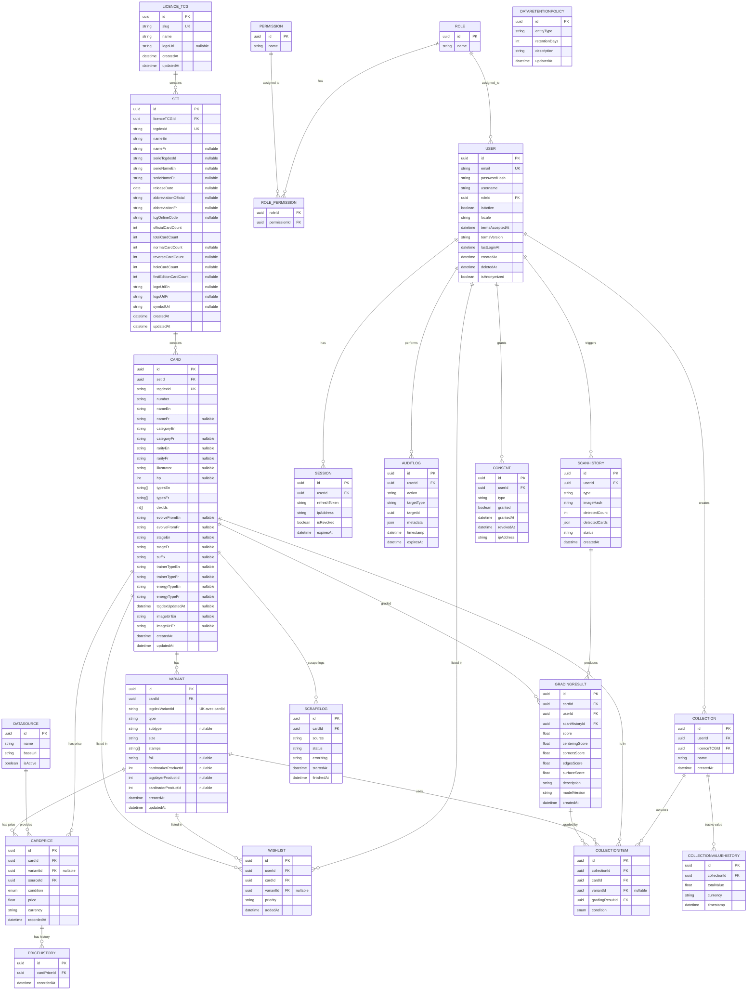

# Schéma DB — TCG App

## Diagramme

## Catalogue des cartes : contrat d'interface (COLLR-684)

`LICENCE_TCG`, `SET`, `CARD` et `VARIANT` sont possédées et migrées par le backend (Prisma, tables `licences_tcg`, `sets`, `cards`, `variants` ; le modèle Prisma de `SET` s'appelle `CardSet` pour ne pas masquer le `Set` de JavaScript). Le microservice TCG ne crée ni ne modifie aucune de ces tables : il y écrit uniquement par UPSERT, sur les clés uniques ci-dessous. Détails et décisions : ADR-015 dans `.claude/contexts/architecture.md`.

| Table | Clé de l'UPSERT | Exemple |
|-------|-----------------|---------|
| `licences_tcg` | `slug` | `pokemon` |
| `sets` | `tcgdexId` | `base1`, `swsh3`, `sv03.5` |
| `cards` | `tcgdexId` | `swsh3-20`, `sv03.5-006` |
| `variants` | `(cardId, tcgdexVariantId)` | `(<id de base1-4>, 4ffrmhcfiaejakhepqdkx7o)` |

- **Identifiants** : `tcgdexId` est l'identifiant TCGdex tel quel, identique en français et en anglais ; il sert de clé de jointure entre les deux langues. `number` est le `localId` TCGdex, en texte (zéros initiaux : `006`). L'`id` UUID est généré par la base (`DEFAULT gen_random_uuid()`) : un INSERT en SQL brut n'a pas à le fournir.
- **`variantId` de TCGdex n'est pas unique à lui seul** : il identifie un *type* d'impression (par exemple « holo, sans ombre, 1re édition ») et se retrouve sur beaucoup de cartes (les 16 premières cartes de `base1` portent les mêmes quatre). Une impression se repère donc par la carte **et** son `variantId`.
- **Français / anglais** : une seule ligne par set et par carte, avec des colonnes `…En` et `…Fr` pour tout ce que TCGdex traduit (noms, catégorie, rareté, types, stade, type de Dresseur et d'Énergie, nom de l'évolution précédente, série, abréviation du set). L'anglais est la référence (obligatoire) ; le français est optionnel car TCGdex ne le couvre qu'à environ 95 %. Les raretés ne sont pas toutes traduites par TCGdex (`Common` / `Commune`, mais `Holo Rare` dans les deux langues) : on stocke ce qu'il renvoie. Les nombres, codes et identifiants (PV, numéros de Pokédex, `suffix`…) sont lus dans la réponse anglaise.
- **Variantes** : les codes (`type`, `subtype`, `size`, `stamps`, `foil`) sont stockés en anglais seulement ; les libellés français de TCGdex sont en partie non traduits (`thank-you`, `pikachu`) et se rendent côté interface. Les types d'impression d'une carte (normale, reverse, holo, 1re édition) se déduisent de `variants`, rien n'est dupliqué sur `cards`.
- **Images** : seules les URL de base du CDN TCGdex sont stockées, sans extension (on ajoute `/high.webp` à l'affichage). Aucune image n'est stockée localement.
- **`updatedAt`** : maintenu par Prisma pour ses propres écritures seulement. Un UPSERT en SQL brut (psycopg) doit le renseigner (`updatedAt = now()`). `cards.tcgdexUpdatedAt` est une autre date : le `updated` de TCGdex, qui permet de ne retraiter que les cartes modifiées.
- **Logo** : `licences_tcg.logoUrl` est une URL, vide dans le seed (TCGdex ne fournit pas de logo de licence) ; la source reste à choisir. Aucun fichier n'est stocké.
- **Hors contrat** : prix, prédictions, légalité en tournoi (`legal`), `regulationMark` (inutiles à un collectionneur), drapeaux `has*` (déductibles de `variants`), et le détail de jeu des cartes (attaques, talents, faiblesses, résistances, coût de retraite, description, effet). Les champs `predictedPrice`, `priceLowerBound` et `priceUpperBound` de l'ancienne `CARD` sont retirés : ils appartiennent au worker de prédiction et n'ont pas encore de ticket backend. Les anciens champs `label` et `imageUrl` de `VARIANT` disparaissent aussi : TCGdex ne donne pas d'image par variante, et `type` / `subtype` / `stamps` / `foil` remplacent le libellé.
